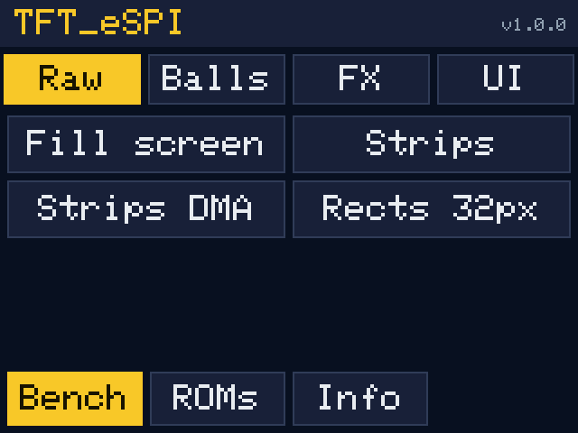
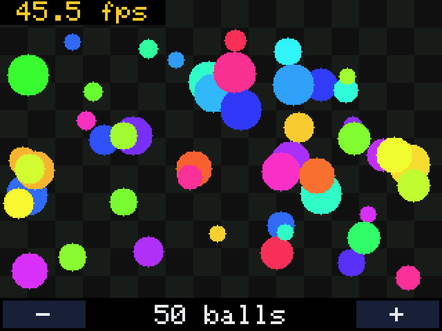
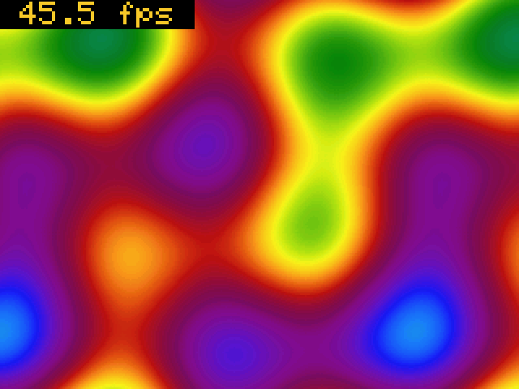
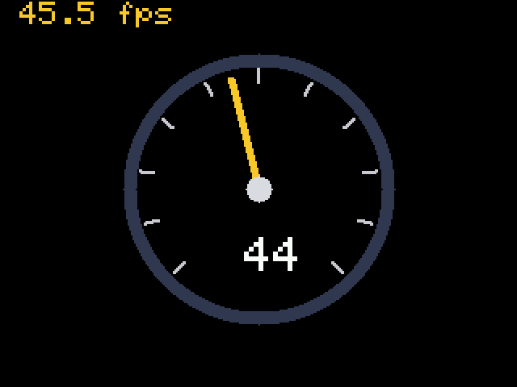
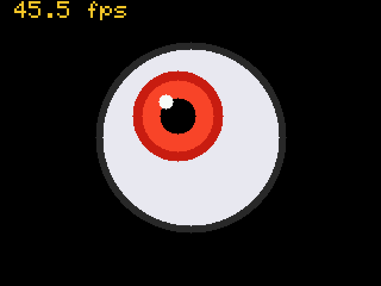
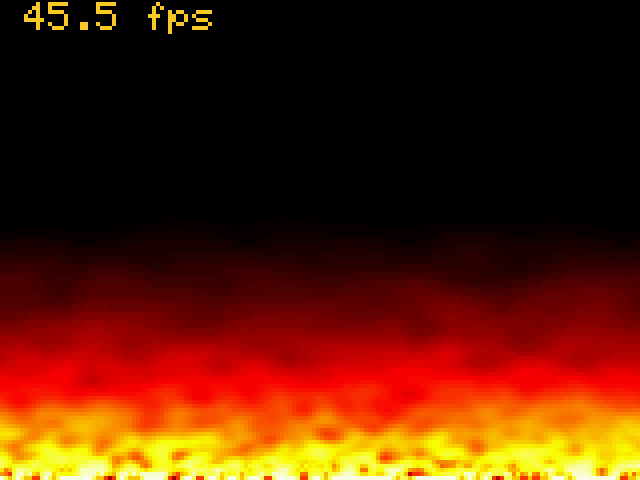
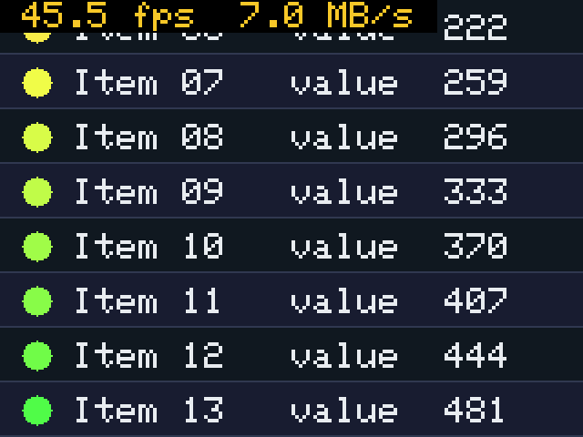

# Animation experiment

How smooth can the ESP32 **Cheap Yellow Display** (ESP32-2432S028R, 2.8" 320×240) animate?
This experiment runs the same set of frame-rate tests with **TFT_eSPI**, **LovyanGFX** and
**LVGL**. Each library is its own ROM, and you can switch between ROMs over Wi-Fi from the
device.



## Install

👉 **Web flasher: <https://martindamp.github.io/CYD-experiments/animation-experiment/>**

1. Open the flasher in **Chrome** or **Edge** on a computer and plug in the CYD by USB.
2. Pick a ROM, click **Install** and choose the serial port.
3. When the install is done, enter your **Wi-Fi** in the flasher (Improv Wi-Fi). Wi-Fi is only
   needed to switch ROMs. The tests themselves don't use it.

## Using it

- **Tabs** (Raw / Balls / FX / UI) group the tests. Tap a test to run it. The FPS is shown
  top-left, updated every 0.5 s. **Tap anywhere** to get back to the menu.
- Tests with a setting (number of balls, SPI clock) have a **[-] value [+]** bar at the bottom.
- **Bench** runs every test for 3 s (after 0.7 s warm-up) and shows a results table. The same
  table is printed on the serial port (115200 baud) as Markdown, so you can paste it straight
  into a note. Tap during a bench to stop it.
- **ROMs** loads `roms.json` from GitHub Pages and lists all ROMs. Tap one to install it over
  the air. Wi-Fi settings are stored in NVS and are kept across ROM switches.
- **Info** shows the SPI clock, the theoretical "wire limit" for full frames, heap, Wi-Fi and so
  on. Here you can also turn **Wi-Fi off** to measure without radio activity. It's turned on
  briefly when you open *ROMs*.

## ROMs

| ROM | Library | What's different |
|---|---|---|
| `tftespi` | TFT_eSPI 2.5 | The setup the other CYD projects use. `SPI_FREQUENCY=55 MHz`, which the ESP32 actually runs at **40 MHz** (80 MHz ÷ 2). |
| `tftespi80` | TFT_eSPI 2.5 | The same, at **80 MHz** SPI. TFT_eSPI's clock is a compile-time setting, so it needs its own ROM. Not every panel can keep up. If the screen is garbled, flash another ROM from the web page. |
| `lovyangfx` | LovyanGFX 1.1 | The same scenes and panel setup, plus **SPI sweep**: change the clock live (10 / 20 / 26.7 / 40 / 80 MHz) and watch the fine grid for errors. |
| `lvgl` | LVGL 8.3 on TFT_eSPI | LVGL widgets and stress tests, rendered into two 320×40 buffers and sent with DMA. |

## The tests

The TFT_eSPI and LovyanGFX ROMs run **identical scene code**. Scenes draw either with the
library's own primitives or with a small software renderer (`src/common/canvas.h`) into RAM
buffers. Then only the transport (how pixels reach the panel) differs between the libraries.

| Tab | Test | What it measures |
|---|---|---|
| Raw | Fill screen | `fillScreen()` in a loop: the panel's raw fill rate, no CPU work. |
| | Strips / Strips DMA | Full frames rendered in 320×40 strips (one colour per row, so almost free) and pushed **blocking** vs. **DMA double-buffered** (CPU renders strip n+1 while DMA sends strip n). |
| | Rects 32px | 100 random 32×32 `fillRect()` per frame: the per-call overhead of small primitives. |
| | SPI sweep | LovyanGFX only. See above. |
| Balls | Direct | N balls erased and redrawn with `fillCircle()`. Fast, but flickers and can't have a background. |
| | Full frame | Checkerboard + N balls, the whole frame rendered in strips and DMA'd. No flicker. The cost is the same whatever N is. |
| | Dirty rects | Only the box around each ball's old and new position is re-rendered and pushed. Very fast for few objects, slower as N grows. |
| FX | Plasma, Plasma 1/2 | Per-pixel maths every frame (sine tables). *1/2* computes 160×120 and doubles each pixel. |
| | Fire | Classic fire simulation at 160×120, scaled 2×. |
| | Starfield | 600 stars in 3D on black. |
| | Rotozoom | A 64×64 texture, rotated and zoomed. Every pixel is sampled. |
| UI | Gauge | Needle + dial, only the 180×180 dial box redrawn (partial update). |
| | Eye | Like CYD-hal9000: pupil wandering, blinking, in a 170×170 box. |
| | Scroll list | Smooth full-screen list scroll (2 px per frame). |
| | Counter | A 6-digit number in a large font, 300×64 box. |
| LVGL | Widgets, Meter, Scroll list | Typical LVGL screens (arc, bars, switch, spinner, `lv_meter`, `lv_list`) with animations. |
| | Full redraw | The whole screen is invalidated every frame: LVGL's worst case. |
| | Moving objs | 5–100 round objects moved every frame. |
| | Big text | A Montserrat 48 counter (anti-aliased text). |

| | | |
|---|---|---|
|  |  |  |
|  |  |  |

*(PC renderings from `tools/sim`. The FPS numbers in the pictures are not real.)*

## What to expect (before measuring)

These numbers come from the SPI maths. The bench on your device gives the real ones.

- A full 320×240 frame in 16-bit colour is 153.6 KB = 1.23 Mbit. At **40 MHz** the bus can carry
  at most **≈ 32 fps**. At **80 MHz** it can carry **≈ 65 fps**. No library can beat that for
  full-screen changes. In practice you get a bit less because of command overhead and the
  time spent rendering.
- A whole frame doesn't fit in one block of RAM on this ESP32, which has no PSRAM. That's why
  everything full-screen is rendered in strips. With DMA, rendering and sending overlap. Without
  DMA, the two times add up.
- **Partial updates** are where smooth animation really comes from. A 180×180 gauge is 42 % of
  the screen, so its limit is ≈ 2.4× the full-frame rate. Small sprites with dirty rectangles
  can run at hundreds of FPS.
- CPU-heavy effects (plasma, rotozoom) are often limited by the CPU, not the bus. *Plasma 1/2*
  shows how much computing fewer pixels buys.
- LVGL adds the cost of a general-purpose renderer (anti-aliasing, styles, layout). Compare
  *Full redraw* with *Strips DMA* to see that cost.

## Build it yourself

PlatformIO project with one env per ROM: `pio run -e tftespi` (or `tftespi80`, `lovyangfx`,
`lvgl`). To flash over USB, use `pio run -e lvgl -t upload`.

A release is made by bumping `VERSION` and pushing to `main`. GitHub Actions
(`.github/workflows/pages.yml` in the repo root) builds every ROM listed in `roms.json`. It then
publishes the flasher, a factory image per ROM and the OTA images + `roms.json` to GitHub Pages.

**Adding a ROM:** add a `[env:<id>]` to `platformio.ini` (with `'-D ROM_ID="<id>"'` and
`'-D ROM_NAME="..."'`), and add an entry to `roms.json`. Keep `desc` under 48 characters so
it fits on the device. Scenes for the TFT_eSPI/LovyanGFX ROMs go in `src/gfx/scenes.cpp`
(the `SCENES` table).

### Screenshots without hardware

`tools/sim/render.sh` compiles the real shell + scene code against mock headers on a PC and
writes `docs/*.png`.

## Layout

```
src/common/   shell (menu, touch, Wi-Fi/Improv, bench, OTA ROM switcher), canvas, font, board pins
src/gfx/      TFT_eSPI + LovyanGFX ROMs: display backends + all scenes
src/lvgl/     LVGL ROM
include/      lv_conf.h
web/          web flasher page (ROM picker)
tools/sim/    PC renderer for screenshots
```

## Troubleshooting

- **Colours wrong / screen black**: see the comments at the bottom of `platformio.ini`.
- **Taps land in the wrong place**: adjust `TOUCH_*` in `src/common/board.h`.
- **"Could not load ROM list"**: the device needs Wi-Fi (reconnect to the web flasher and choose
  *Connect to Wi-Fi*). GitHub Pages must be deployed at least once.
