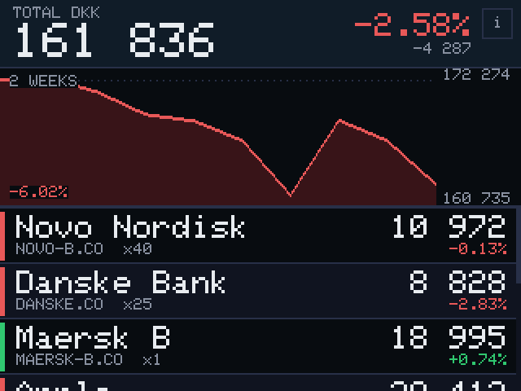
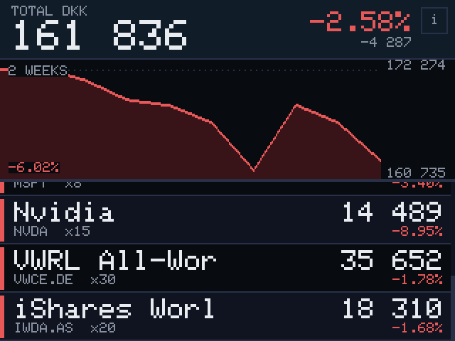
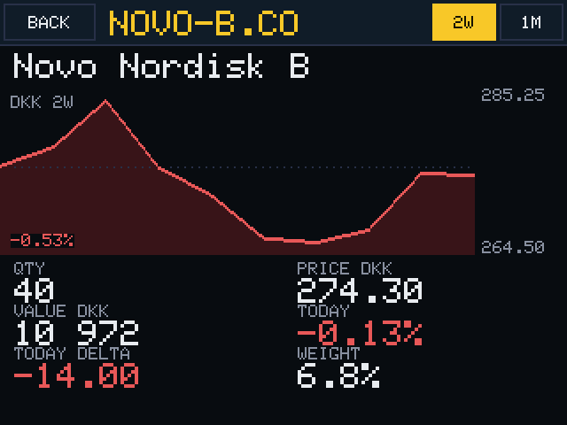
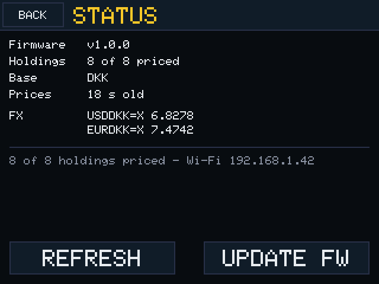

# Portfolio tracker

A desk display for a portfolio of securities on the ESP32 **Cheap Yellow Display**. It shows the
total value, a chart of the last two weeks, and a scrollable list of every holding with today's
change — tap one for its own chart. Built on the same rendering setup as
[space-game](../space-game/): TFT_eSPI at **80 MHz SPI**, the whole frame rendered in 320×40
strips and sent with double-buffered DMA.

| | |
|---|---|
|  |  |
|  |  |

*(PC renderings from `tools/sim`, built from real recorded API responses.)*

## Install

👉 **Web flasher: <https://martindamp.github.io/CYD-experiments/portfolio-tracker/>**

Install it and enter your Wi-Fi when the flasher asks. On the first boot the tracker fetches
`portfolio.json` and the prices and then shows the overview. The **i** button opens the status
screen, where **UPDATE FW** checks GitHub Pages and installs a newer version over the air.

## Your holdings: `portfolio.json`

The device fetches [`portfolio.json`](portfolio.json) from GitHub Pages on every refresh, so
changing your portfolio is a commit to `main` — no reflash.

```json
{
  "base": "DKK",
  "holdings": [
    { "ticker": "NOVO-B.CO", "qty": 40 },
    { "isin": "US0378331005", "qty": 12, "name": "Apple", "currency": "USD" }
  ]
}
```

| Field | |
|---|---|
| `ticker` | A Yahoo Finance symbol: `NOVO-B.CO`, `AAPL`, `VWCE.DE`, `IWDA.AS`. |
| `isin` | Used instead of `ticker`. Resolved once through the search endpoint and cached in NVS. Prefer a ticker — that endpoint rate-limits (HTTP 429). |
| `qty` | How many you hold; fractions are fine. `quantity` and `shares` also work. |
| `name` | Optional display name. Defaults to the name the API reports. |
| `currency` | Optional. Giving it skips one API call per holding on the first boot. |
| `base` | The currency everything is converted to (default `DKK`). |

> ⚠️ This repository is public, so whatever you put in `portfolio.json` is public too. The file
> that ships here is an example — replace it with your own holdings, or fork the repo and point
> `PAGES_BASE` in `src/board.h` at your fork.

## Where the numbers come from

The Yahoo Finance **spark** endpoint returns daily closes for many symbols in a single request,
so one HTTPS call per refresh covers the whole portfolio plus the FX pairs it needs:

```
https://query1.finance.yahoo.com/v8/finance/spark?interval=1d&range=1mo&symbols=NOVO-B.CO,AAPL,USDDKK=X
```

No account and no API key. Two more endpoints are used only on a cold boot, and both results are
cached in NVS: `/v1/finance/search` turns an ISIN into a symbol, and `/v8/finance/chart` reports
a symbol's quote currency.

- **Currency.** Every holding is converted with the FX rate *of that day* (`USDDKK=X` and
  friends, fetched in the same call), so the chart is correct for a mixed-currency portfolio.
  A quote currency ending in a lowercase letter (`GBp` = London pence) is divided by 100.
- **Different trading calendars.** The chart's day grid is the union of the days any holding
  traded on. A holding that did not trade on a given day keeps its last close, so a Danish
  holiday does not make the portfolio dip.
- **Today's change** is the API's own `fulldayChangePercent` per holding; for the portfolio it is
  the step between the last two days of the grid, so it matches the chart.
- **Refresh** every 5 minutes, or from the status screen. Fetches block the UI for a few
  seconds; the **i** button blinks while one runs.

## Code layout

| File | |
|---|---|
| `src/portfolio.cpp` | The model: parsing, the FX/day-grid maths, the totals. Hardware-free. |
| `src/ui.cpp` | Every screen, drawn through `Canvas` only. Hardware-free. |
| `src/net.cpp` | Improv Wi-Fi, the HTTPS fetches, OTA. |
| `src/main.cpp` | TFT + touch + DMA strips, and the refresh loop. |
| `src/jsonlite.h` | A read-only JSON scanner — no allocation, no library, runs on the PC too. |
| `src/api_certs.h` | Root CAs for HTTPS. Regenerate with `python3 tools/gen_certs.py > src/api_certs.h`. |
| `src/canvas.h`, `src/font5x7.h` | Copies of animation-experiment's; keep fixes in sync. |

## Simulator

`tools/sim/render.sh` compile-checks `net.cpp` and `main.cpp` against the mock headers, then
builds and runs the real `portfolio.cpp` + `ui.cpp` against the recorded API responses in
`tools/sim/fixtures/`. It prints the computed values and writes `docs/*.png`. Needs `g++`,
`python3` and Pillow — no hardware and no network.

```bash
tools/sim/render.sh
```

## Troubleshooting

| Symptom | |
|---|---|
| `Could not load portfolio.json` | Wi-Fi, or the file is not on Pages yet (it is published by `tools/build_site.py` via `site_files` in `roms.json`). |
| `Price API did not answer` | Usually TLS: the API's CA may have rotated out of `src/api_certs.h`. Regenerate it with `tools/gen_certs.py`. |
| `No symbol found for <ISIN>` | The search endpoint rate-limits. Put the ticker in `portfolio.json` instead. |
| A holding says `no price` | The symbol is wrong, or it is not quoted on Yahoo Finance. Check it on finance.yahoo.com. |
