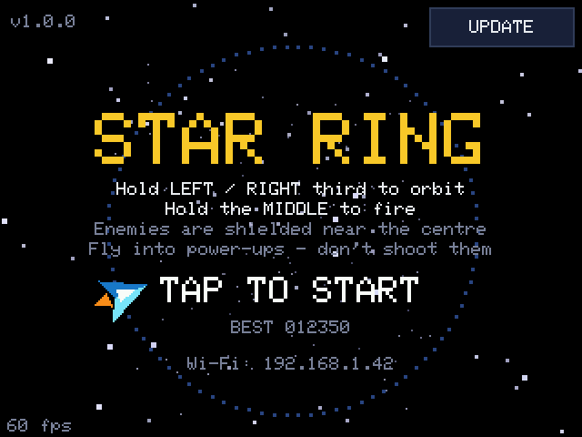
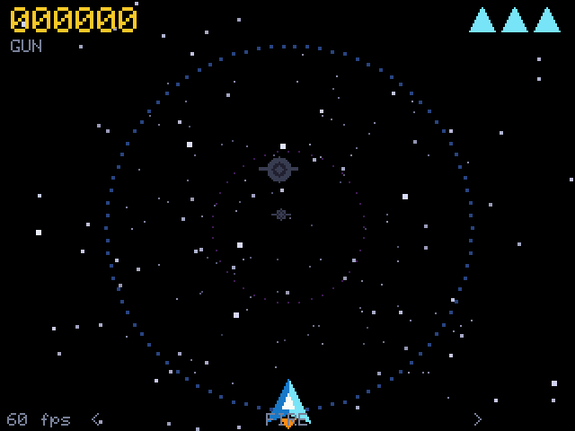
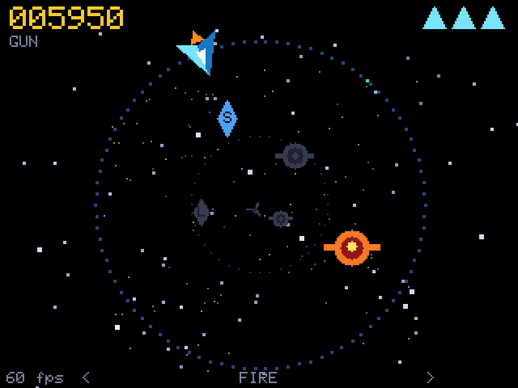
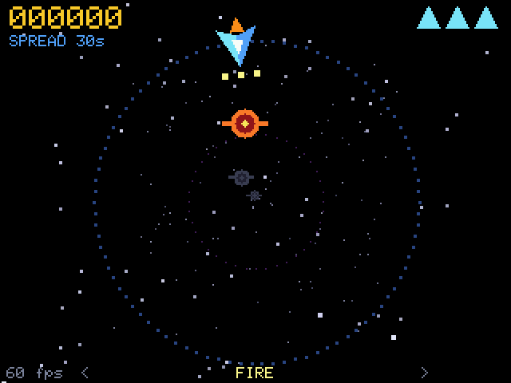
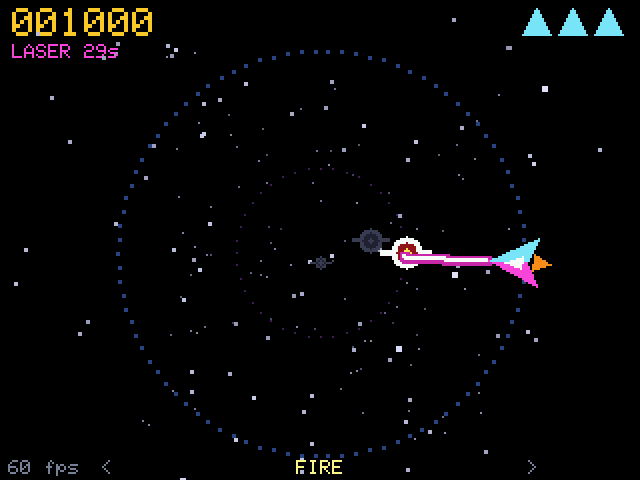
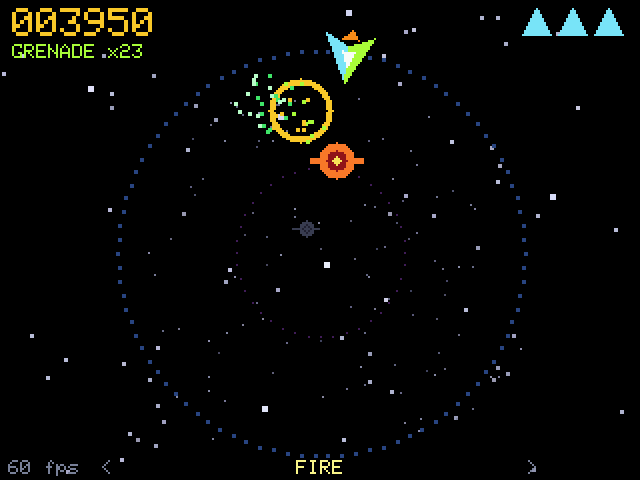

# Star Ring (space game)

The building blocks for a space game on the ESP32 **Cheap Yellow Display**, built on the fastest
setup from [animation-experiment](../animation-experiment/): TFT_eSPI at **80 MHz SPI**. The
whole frame is rendered in 320×40 strips and sent with double-buffered DMA.

| | |
|---|---|
|  |  |
|  |  |

*(PC renderings from `tools/sim`.)*

## Install

👉 **Web flasher: <https://klyver78.github.io/CYD-Martin-Pro/space-game/>**

Install it, enter your Wi-Fi when the flasher asks (only used for updates), and tap the screen
to start. **UPDATE** on the title screen checks GitHub Pages and installs a newer version over
the air.

## The game

- A starfield flies towards you, so it feels like flying into the screen.
- The **ship** moves on a ring and always points at the centre.
- **Touch zones**: hold the **left third** of the screen to orbit counter-clockwise, the
  **right third** to orbit clockwise, and the **middle third** to fire. Hints are shown at the
  bottom.
- **Enemies** spawn in the centre (far away) and fly out to a fixed point on the ring. They
  grow as they come closer.
  - **Shield zone**: inside the inner dotted circle, enemies are shielded and drawn as dark
    "ghosts". Shots fizzle at the edge of the zone. So you can't sit in one spot and shoot
    everything as it leaves the centre. You have to move under the enemy's path once it's out.
  - **Saucer** (orange): flies straight out. 1 hit, 100 points.
  - **Spinner** (green, rotating): spirals out. 2 hits (flashes white on the first), 250 points.
- **Power-ups** (spinning diamonds) fly out like enemies, one every 12–20 s. **Catch** one by
  being where it reaches the ring. **Shoot** one (or blow it up) and it's destroyed. It's
  shielded in the centre too.
  - **S – Spread**: three shots at a time, for 15 s.
  - **L – Laser**: a continuous beam while you fire. It damages everything on your line outside
    the shield zone. Lasts 9 s.
  - **G – Grenades**: 8 slow shells that explode on impact, or at the edge of the shield zone,
    and hit everything within the blast. Mind nearby power-ups.
  - The active weapon is shown under the score, and in the colour of the ship's wing.
- An enemy that reaches the ring where your ship is costs a life and your power-up. You have 3,
  and you blink and can't be hit for 2 s after losing one. Other enemies explode harmlessly on
  the ring.
- Difficulty ramps up over about two minutes: more enemies, faster, more spinners.
- The best score is saved on the device (NVS).

| | | |
|---|---|---|
|  |  |  |

## Code

```
src/game.cpp   all game logic + rendering (no hardware: polar coordinates, fixed tuning at the top)
src/main.cpp   TFT_eSPI DMA strip loop, touch (held side = turn, new press = tap), best score
src/net.cpp    Improv Wi-Fi + OTA from GitHub Pages (roms.json version check)
src/canvas.h   software renderer (copied from animation-experiment, + fillTriangle)
tools/sim/     runs the real game.cpp on a PC with a simple bot player -> docs/*.png
```

The game logic is frame-rate independent (`dt` in seconds). Tuning lives at the top of
`game.cpp` (ring radius, turn speed, fire rate, lives) and in `spawnEnemy()` (speeds, how
many are spinners). Weapon tuning (fire rates, durations, laser damage, blast radius) is next
to `enum Weapon`, and the shield size is `IMMUNE_R`.

Build: `pio run -e game`. Release: bump `VERSION` and push to `main`.

## Troubleshooting

- **Garbled screen**: lower `SPI_FREQUENCY` in `platformio.ini` to 55 MHz (that's 40 MHz real).
- **Left/right swapped**: `TOUCH_FLIP_X` in `src/board.h`.
