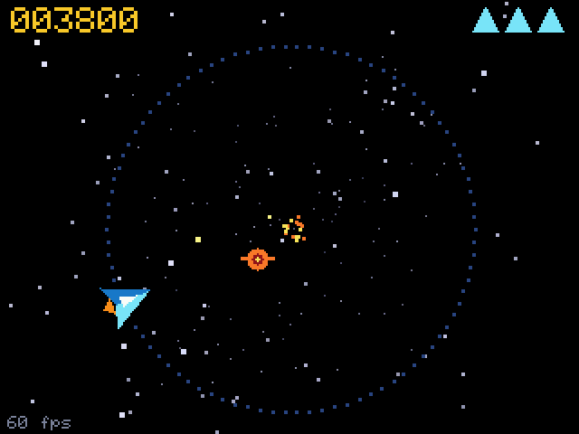
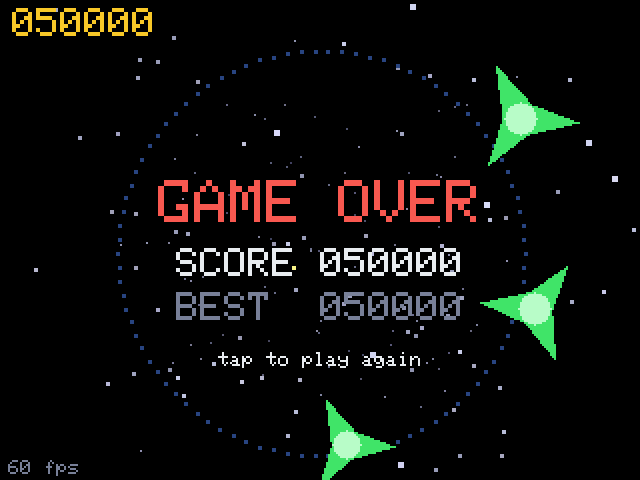

# Star Ring (space game)

The building blocks for a space game on the ESP32 **Cheap Yellow Display**, built on the fastest
setup from [animation-experiment](../animation-experiment/): TFT_eSPI at **80 MHz SPI**. The
whole frame is rendered in 320×40 strips and sent with double-buffered DMA.

| | |
|---|---|
|  |  |
|  |  |

*(PC renderings from `tools/sim`.)*

## Install

👉 **Web flasher: <https://martindamp.github.io/CYD-experiments/space-game/>**

Install it, enter your Wi-Fi when the flasher asks (only used for updates), and tap the screen
to start. **UPDATE** on the title screen checks GitHub Pages and installs a newer version over
the air.

## The game

- A starfield flies towards you, so it feels like flying into the screen.
- The **ship** moves on a ring and always points at the centre. Hold the **left half** of the
  screen to orbit counter-clockwise and the **right half** to orbit clockwise. The ship
  speeds up and slows down smoothly.
- **Auto fire** shoots straight at the centre, so you aim by orbiting.
- **Enemies** spawn in the centre (far away) and fly out to a fixed point on the ring. They
  grow as they come closer.
  - **Saucer** (orange): flies straight out. 1 hit, 100 points.
  - **Spinner** (green, rotating): spirals out. 2 hits (flashes white on the first), 250 points.
- An enemy that reaches the ring where your ship is costs a life. You have 3, and you blink and
  can't be hit for 2 s after losing one. Other enemies explode harmlessly on the ring.
- Difficulty ramps up over about two minutes: more enemies, faster, more spinners.
- The best score is saved on the device (NVS).

## Code

```
src/game.cpp   all game logic + rendering (no hardware: polar coordinates, fixed tuning at the top)
src/main.cpp   TFT_eSPI DMA strip loop, touch (held side = turn, new press = tap), best score
src/net.cpp    Improv Wi-Fi + OTA from GitHub Pages (roms.json version check)
src/canvas.h   software renderer (copied from animation-experiment, + fillTriangle)
tools/sim/     runs the real game.cpp on a PC with scripted input -> docs/*.png
```

The game logic is frame-rate independent (`dt` in seconds). Tuning lives at the top of
`game.cpp` (ring radius, turn speed, fire rate, lives) and in `spawnEnemy()` (speeds, how
many are spinners).

Build: `pio run -e game`. Release: bump `VERSION` and push to `main`.

## Troubleshooting

- **Garbled screen**: lower `SPI_FREQUENCY` in `platformio.ini` to 55 MHz (that's 40 MHz real).
- **Left/right swapped**: `TOUCH_FLIP_X` in `src/board.h`.
